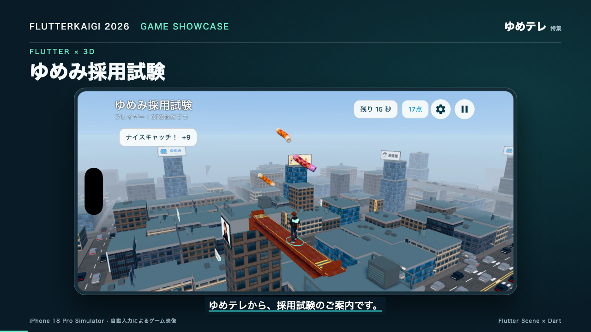
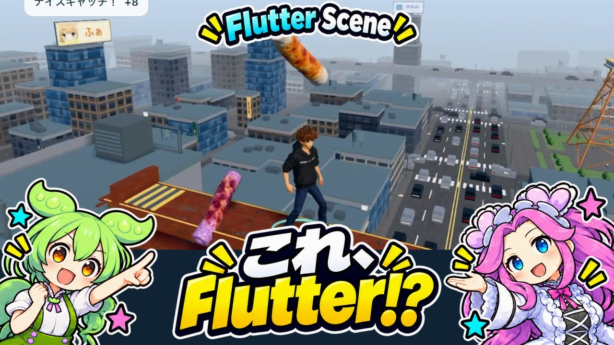

# ゆめみ採用試験

**採用試験の会場は、赤坂の空の上。**

FlutterKaigi 2026向けに制作している、Flutter Scene製の3Dミニゲームです。高層ビルの間に架かった鉄骨を歩き、空から降ってくる「あたり」をキャッチ。端末を傾けて移動し、スワイプで見回して、80点以上の合格を目指します。

<p>
  <a href="https://www.youtube.com/watch?v=sv6l7ZY-i70"></a>
  <a href="https://www.youtube.com/watch?v=81XlfHfG8N4"></a>
</p>

**[▶ ゲームトレーラー](https://www.youtube.com/watch?v=sv6l7ZY-i70) · [▶ 技術解説動画](https://www.youtube.com/watch?v=81XlfHfG8N4)**

<details>
<summary>トレーラーの収録・制作について</summary>

iPhone 18 Pro／iOS 27シミュレーターの標準録画で収録し、2622×1206・60fpsで編集。3人のキャラクター選択、昼夜の赤坂、実際のプレイを紹介します。プレイ映像は撮影用の自動入力で動かしています。ナレーションはゆめテレアナウンサー（Irodori-TTS）。[映像の制作・再生成手順](tools/readme-video/README.md)

</details>

## 遊び方

1. **キャラクターと昼・夜を選ぶ。** キャラクターごとに難易度と落下物が変わります。
2. **端末を傾けて移動する。** 落下地点へ先回りすると自動でキャッチ。左右スワイプでカメラが30度ずつ回り、ピンチで拡大・縮小できます。
3. **約18〜20秒の一本勝負。** あたりを取った割合で100点満点に換算し、はずれは1回10点減点。80点以上で合格です。

| キャラクター | 難易度 | キャッチするもの | 避けるもの |
| --- | --- | --- | --- |
| 福ギュン | イージー | ゆめみん | やめ太郎 |
| CTOおだてつ | ノーマル | ちくわ | 毒ちくわ |
| そば屋 | ハード | ビール（窓際スーパーつらい・窓際ライト） | 発泡酒「つらめ」 |

配置はキャラクターごとに固定。同じ条件で何度でも挑戦できます。時間制限・採点なしの「お試し」で操作に慣れ、ラウンド後はニックネームを付けて端末内のランキングに記録できます。表示言語は日本語・英語に対応しています。

## 街も、キャラクターも、Flutterで

- **昼と夜の赤坂。** 東京タワー、屋上の看板、走る車、窓明かり。カメラは鉄骨のまわりを一周できます。
- **3Dギャラリー。** キャラクターや落下物を回転・拡大し、アニメーションを鑑賞。街を探索したり、協賛看板を眺めたりできます。
- **中身を触れる設定画面。** 画質やゲームバランスを調整でき、TASモードでは100点になる入力の自動再生を実演できます。TASの結果はランキングに残りません。

描画は [Flutter Sceneのfork](https://github.com/K9i-0/flutter_scene)、ゲームの進行・判定はDart、画面UIはFlutterで実装しています。GLBのキャラクターと街をビルドフックで変換し、Flutter GPUで描画します。

詳しい仕様・自動操作・開発記録は [app/README.md](app/README.md)、性能の測定結果・考察・改善の履歴は [パフォーマンスの記録](app/PERFORMANCE.md) を参照してください。紹介映像はdebugビルドの収録で、実機性能のベンチマークではありません。

## ローカルで動かす

iOSで動かす場合はmacOS、Xcode、iOS Simulator、[mise](https://mise.jdx.dev/) が必要です。

```sh
git clone https://github.com/K9i-0/flutterkaigi2026.git
cd flutterkaigi2026
mise trust .mise.toml
mise install
cd app
mise exec -- flutter pub get
open -a Simulator
mise exec -- flutter devices
mise exec -- flutter run -d <device-id>
```

- Flutterは `.mise.toml` に固定した **3.47.8** を使います。
- 初回はビルドフックがGLBを変換するため、起動に時間がかかります。
- 素材は相対シンボリックリンクで共有しています。`app/` だけを切り出さず、リポジトリごとcloneしてください。
- シミュレーターでは端末の傾きの代わりに矢印キーを使います。
- VS Codeではリポジトリのルートを開き、「ゆめみ採用試験 (debug)」を選んでF5で起動できます。
- AndroidはAndroid SDKと端末／エミュレーターを用意し、同じ `flutter run` コマンドで起動します。

### 検証・自動操作

`app/` で実行します。

```sh
mise exec -- flutter analyze
mise exec -- flutter test
python3 tool/audit_stage_asset.py
```

UIの自動操作はDart MCPとMarionette MCP（[.mcp.json](.mcp.json)）を使用します。Marionetteはアプリ側と同じ版が必要です。

```sh
mise exec -- dart pub global activate marionette_mcp 0.7.0
```

`madogiwa.inspectCatch` で状態を取得し、`madogiwa.catchAction` で選択・開始・時間送り・撮影デモなどを操作できます。[引数の一覧](app/README.md#自動操作と撮影)

## リポジトリの構成

| パス | 内容 |
| --- | --- |
| [app/](app/) | ゆめみ採用試験のFlutterアプリ本体 |
| [assets/](assets/) | 完成版の共有素材：3Dモデル、ステージ、画像、音声 |
| [characters/](characters/) | キャラクター設定、正典写真、キャラクターシート、小道具・声の参照 |
| [packages/](packages/) | 共有Dartパッケージ：`madogiwa_engine`、`flutter_scene_vrm` |
| [labs/](labs/) | そば屋ハザード、VRM・モーションなどの過去のゲームと検証アプリ |
| [tools/](tools/) | 素材生成・監査スクリプト、README紹介映像のRemotionプロジェクト |

## 素材の原本について

このリポジトリには、ゲームが実際に読み込む完成版の素材だけを入れています。3Dモデルの作業ファイル（Blenderの原本、リグの元データ、ボクセルの原本など）、過去の動画の台本・生成物、Webサイトは [Madogiwa Multimedia Universe](https://github.com/K9i-0/madogiwa-multimedia-universe) に残っています。原本から再生成するスクリプトの一部は、それらの素材があるMMU側で実行する前提です。

## 来歴

2026-10-19に、Madogiwa Multimedia Universeの `flutterkaigi2026` ブランチから独立しました。2026-10-21に、ゆめみ採用試験とFlutter Scene系のゲームだけを残すようgit履歴ごと整理しています。詳細は [MIGRATION.md](MIGRATION.md) を参照してください。

作品・IPの名前は「窓際族物語」です。元は同僚のそば屋さん（[sobaya-0141](https://github.com/sobaya-0141)）の [Seedance_Madogiwa](https://github.com/sobaya-0141/Seedance_Madogiwa) から始まったプロジェクトです。
